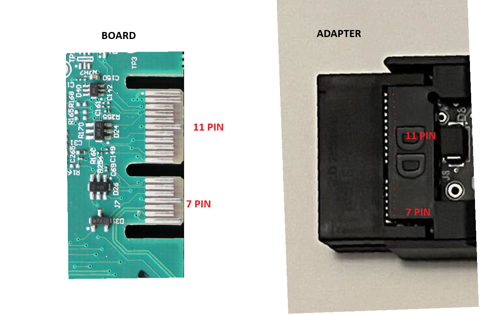
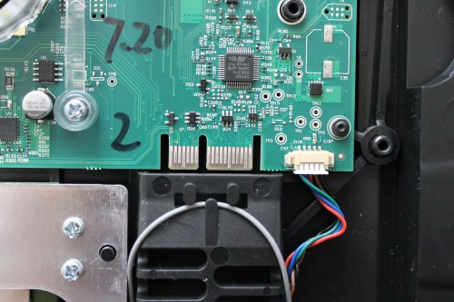
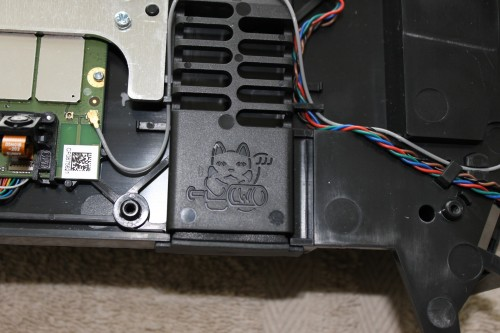
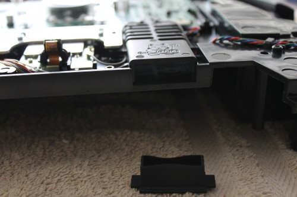

# roomba-link

**Reverse-engineering the iRobot Roomba i7+'s internal factory/debug
connector, with the goal of designing and open-sourcing an adapter board
for it** — the same idea as Create 3's official Adapter Board, but for a
consumer Roomba that never got one.

Independent hobbyist reverse-engineering notes — no extracted firmware or
copyrighted iRobot content included. Not affiliated with iRobot. (Full
disclaimer at the bottom of this README.)

## What this is

A write-up of what I've learned taking apart and emulating my own robot
vacuum — understanding the SoC architecture, how the Linux side talks to
the motor-control side, and how the factory/debug connector works —
building toward an open-source adapter board that plugs into that
connector, the same way Create 3's official Adapter Board does for
iRobot's educational robot. The adapter design itself (schematic, PCB,
BOM) will be original work released here once it's ready; nothing about
it is copied from iRobot.

## Goals

This started as curiosity ("can I even get this thing booting outside the
robot") and has turned into a longer-term personal project. The goals,
roughly in order:

1. **Design and open-source an adapter board** for the i7+'s internal
   factory/debug connector — fully mapped pinout, schematic, and PCB
   files anyone can fabricate or order themselves, the main deliverable
   of this project and the thing that makes everything below possible
2. **Get a real console/shell on the Linux side of the robot**, via that
   connector (USB ADB/serial), without relying on anything cloud-mediated
3. **Cut the cloud connection at the OS level** — not just filtering
   network traffic, but actually disabling/removing the components that
   phone home, so the robot runs fully locally
4. **Attach an external companion computer** (a Raspberry Pi, following
   the same architecture iRobot itself used for the Create 3 robot — same
   platform, officially supported pattern, just not sold for this model)
5. **Add sensors the stock robot doesn't have** — LIDAR, additional
   cameras — run as peers to the robot's own ROS2 graph rather than bolted
   on with no awareness of the robot's existing behavior
6. **Repurpose it as a general-purpose research/hobby robotics platform**,
   similar in spirit to what Create 3 was before iRobot discontinued it —
   a mobile base with real sensors and compute, just assembled from a
   consumer unit instead of bought as an SKU

None of this involves modifying or redistributing iRobot's firmware. The
plan is to design our own open hardware — schematics and PCB files we
publish ourselves — to physically reach the connector, then run
*additional* software alongside the stock system, the same way Create 3's
officially-sold Adapter Board did.

## What this is NOT

- Not a firmware download / mirror
- Not a jailbreak toolkit
- Not an attack guide against other people's robots
- Not reverse-engineered code dumped verbatim from the device

If you're looking for firmware files, this isn't the place — go to iRobot's
own OTA infrastructure or ask them directly.

## Firmware analyzed

So contributors can reproduce or cross-check findings, here's exactly
what this analysis is based on:

- **Robot:** iRobot Roomba i7+
- **Firmware version** (from `/etc/version` on the extracted rootfs):
  `lewis+22.52.10+2023-10-03-e032ab4903c+Firmware-Build+4820`
- **Internal platform codename:** `lewis`
- **SoC:** Qualcomm MSM8909

"`lewis`" and the version/build numbers above are the strings to match
against when looking for the same (or a comparable) image in the
third-party archive linked under [References](#references) — we are not
redistributing the image itself, only citing which one we used.

## Findings so far

### Hardware
- Three-board architecture: STM32F030C8T6 (motor/mobility control) +
  Qualcomm MSM8909 SoC daughtercard (Linux/vSLAM/camera) + Trident AXC-Y1
  Wi-Fi/BT combo module (FCC ID ZW9AXCY1)
- An internal factory/debug access connector matching the pin count and
  keying-notch position of a standard PCIe x1 edge connector (18 gold
  fingers per face, 36 contacts, split 11+7 by the notch). A PCIe x1 slot
  connector mates with it once guide rails are heat-formed into the sides
  of the slot's plastic housing. Only the mechanical form factor matches;
  the signals are not PCIe.
- This same physical connector appears to match the one iRobot's
  (discontinued) Create 3 educational robot exposes via its official
  "Adapter Board" for USB-C/BLE companion-computer access
- First complete multimeter pass over all 36 contacts, summarized here and
  tabulated in [reference/connector-pinout.md](reference/connector-pinout.md):
  - 7 ground pins, and 4 pins on one 5 V net that the robot sources on
    battery power
  - A probable USB device port on face-down pins 2 to 6, in micro-USB order
    (VBUS, D-, D+, ID, GND), with D+ at 3.29 V and D- at 0 V. Inferred from
    the readings; not yet confirmed against a host
  - A few live-looking signal pins, including a roughly 28.9 kHz PWM-like
    line on face-up 6, and 11 pins that look unconnected
  - No unregulated battery voltage appears on the connector

### Software/protocol
- The Linux side enumerates as a USB composite gadget (VID `05C6`,
  PID `9091`) offering RNDIS (networking), Qualcomm DIAG, ACM (serial
  console), and ADB — depending on provisioning/lock state
- A local TLS-wrapped MQTT service exists for direct app-to-robot
  communication on the local network, independent of the cloud path
  (this overlaps with what the home-automation community has already
  documented for Roomba 900-series+ robots)
- Architecture naming suggests this platform's lineage traces back to an
  earlier Intel Edison-based compute module generation, even though
  current hardware has moved to Qualcomm

## Photos

**Pin-count comparison** — the i7+ mainboard's edge connector (11+7 pins,
split by a keying notch) next to the Create 3 Adapter Board's mating
connector (own work):



**Create 3's official Adapter Board hookup** (iRobot's own documentation,
linked rather than mirrored — see [References](#references)):

[iRobot Create 3 Adapter Board hookup photo](https://iroboteducation.github.io/create3_docs/hw/data/hookup_piZ.jpg)

**Inside the i7+** — teardown photos showing the factory/debug connector
in place on the mainboard. These three are **not my photos**; they were
taken by forum member [vic7767](https://robotreviews.com/chat/memberlist.php?mode=viewprofile&u=1074)
and posted on [RobotReviews.com](https://robotreviews.com/), used here for
reference/identification purposes with credit:





## References

- [irobot-firmware-archive](https://github.com/BookCatKid/irobot-firmware-archive) —
  third-party archive of iRobot firmware images (not mirrored here; linked
  for anyone doing their own independent analysis)
- [iRobot Create 3 docs](https://iroboteducation.github.io/create3_docs/) —
  official documentation for iRobot's (discontinued) educational robot,
  which shares the underlying hardware platform with consumer Roombas
- [Create 3 Adapter Board hookup photo](https://iroboteducation.github.io/create3_docs/hw/data/hookup_piZ.jpg) —
  shows the official companion-computer connector this project is trying
  to replicate access to
- Teardown photos: forum member [vic7767](https://robotreviews.com/chat/memberlist.php?mode=viewprofile&u=1074)
  on [RobotReviews.com](https://robotreviews.com/)

## Open questions / help wanted

- [ ] Confirm the probable USB D-/D+ lines (face-down 3 and 4) by
      connecting them to a PC and checking that it enumerates a device
- [ ] Identify the remaining signal pins (a possible UART on face-down 13
      or face-up 16, and the PWM-like line on face-up 6) with a logic
      analyzer — see [reference/pin-mapping-plan.md](reference/pin-mapping-plan.md)
      for the probing procedure and [reference/connector-pinout.md](reference/connector-pinout.md)
      for the measured map
- [x] Identify whether a standard PCIe x1 slot connector mechanically
      mates with this connector — it does, once guide rails are
      heat-formed into the sides of the slot's housing
- [ ] Anyone with a second i7+ who can repeat the readings and confirm the
      map is not specific to one unit
- [ ] Anyone with teardown experience on other iRobot models (Create 3,
      other Roomba generations) who can confirm/deny shared connector
      design across the product line

## Tools in this repo

Original tooling written for this project (operates on firmware the user
supplies themselves; does not include or require redistributing any
firmware):
- `otps_unpack.py` — parser for iRobot's custom "Otps" OTA container format
- `extract_rootfs.py` — pulls the SquashFs rootfs out of the unpacked
  image onto disk (Windows-safe: symlinks/device nodes go in a manifest
  instead, since Windows can't hold them)
- `build_initramfs.py` + `init.sh` — repack the extracted rootfs into a
  bootable initramfs with our own minimal `/init`, standing in for the
  robot's real systemd/hardware bring-up
- `robot_vm.py` / `boot_interactive.bat` — boot the resulting image in
  QEMU (`qemu-system-arm`, generic `virt` machine, no network device) and
  interact with it over the emulated serial console
- `adapter-board/` — *(coming soon)* original KiCad schematic/PCB files
  for the open-source adapter board; the pinout is now measured, and the
  USB lines still need confirming before the schematic is drawn
- `explore.py` — quick grep-by-regex over a SquashFS image's path list,
  for poking around a rootfs before fully extracting it
- `strs.py` — minimal `strings`-equivalent (prints runs of printable
  ASCII of a given minimum length from any binary file)
- `reference/iRobot_Create_3_Public_Model.step` — iRobot's own
  publicly-released CAD model of the Create 3 robot, used for
  dimensional/physical reference when comparing to the i7+ (downloaded
  as-is from iRobot's own [create3_docs](https://github.com/iRobotEducation/create3_docs)
  repo; not modified)

See [Unpacking the firmware and running it in QEMU](#unpacking-the-firmware-and-running-it-in-qemu)
for step-by-step instructions.

## Unpacking the firmware and running it in QEMU

This walks through going from a firmware image you've sourced yourself to
an interactive shell in an emulated version of the robot's Linux
userland — no hardware required. None of these scripts include or
require redistributing any firmware; you supply the image.

**You will need:**
- Python 3 with the `PySquashfsImage` package (`pip install PySquashfsImage`)
- [QEMU](https://www.qemu.org/) with `qemu-system-arm` on your PATH, or
  set the `QEMU_SYSTEM_ARM` environment variable to its full path
- A generic ARM Linux kernel + initrd-capable `virt`-machine support —
  a stock Debian `linux-image-armmp` kernel works and avoids needing the
  robot's own hardware-specific boot chain (which won't boot under QEMU's
  generic `virt` machine anyway)
- A firmware image for the i7+ — see [References](#references) for where
  people have archived these; this repo does not host or mirror one

**1. Get a firmware image.** Source it yourself (see References). You
should end up with a `.signed` (or similar) OTA package file.

**2. Unpack the OTA container.**
```
python -I otps_unpack.py package.signed work/parts
```
This walks the `Otps` container's nested chunks (`Sdat`/`Otpc`/`Otim`/
`Otie`) and dumps any leaf chunk bigger than 4&nbsp;KB to `work/parts/`.
Run it with no output dir first to just print the tree and find which
chunk is the SquashFS rootfs image.

**3. Extract the SquashFS rootfs.**
```
python -I extract_rootfs.py work/parts/<rootfs_chunk>.bin work/rootfs
```
Regular files land on disk under `work/rootfs/`; symlinks and device
nodes (which Windows can't represent) are recorded in
`work/rootfs_manifest.tsv` instead and re-applied at the next step.

**4. Get a generic ARM kernel.** Download a Debian `armmp` kernel package
(e.g. `linux-image-6.1.0-*-armmp`) and pull `vmlinuz-*` out of it into
`work/kernel/`. This is a stock upstream kernel, not anything extracted
from the robot — it's only there to boot the rootfs under QEMU.

**5. Build the initramfs.**
```
python -I build_initramfs.py work/rootfs work/rootfs_manifest.tsv init.sh work/robot-initramfs.cpio.gz
```
This packs the extracted rootfs (with correct modes/symlinks from the
manifest) into a gzip'd cpio archive, injecting `init.sh` as `/init` in
place of the robot's real systemd bring-up — `init.sh` just mounts
`/proc`, `/sys`, `/dev`, `/tmp`, `/run`, brings up loopback, and drops you
into a BusyBox shell.

**6. Boot it.**
- Interactively, with the console in your terminal:
  ```
  boot_interactive.bat
  ```
  (Ctrl+A then X to quit QEMU.)
- Or scripted, to run specific shell commands and capture their output:
  ```
  python robot_vm.py "uname -a" "ls /opt/irobot/bin"
  ```

The emulated machine boots with `-nic none` — it's fully offline
(loopback only), by design, so nothing it does can reach the real cloud
or your network. You now have a shell on an emulated copy of the robot's
Linux userland to poke around in safely, separate from the actual
hardware.

**What it actually looks like**, a real transcript from `robot_vm.py`:

```
$ uname -a
Linux (none) 6.1.0-50-armmp #1 SMP Debian 6.1.176-1 (2026-07-02) armv7l GNU/Linux

$ cat /etc/version
lewis+22.52.10+2023-10-03-e032ab4903c+Firmware-Build+4820

$ ls /opt/irobot/bin | head -15
bluetooth_manager
cleantrack
cloud_manager
connectivity_manager
crashpad_handler
create-wifi-logs.sh
curl_test_tool
edison-monitor-logs
file-upload-streamer
file_xfer_manager
fl_client
local_manager
logger_install.sh
manufacturing
monitor-logs

$ whoami
root
```

(The kernel/`uname` line is the generic Debian `armmp` kernel standing in
for the robot's own boot chain — see step 4 above. Everything else is
the actual extracted robot userland running for real, just emulated and
fully offline.)

## License

Code/tools in this repo: MIT
Documentation/write-ups: CC-BY-SA 4.0

This license applies only to original content in this repository. It does
not grant any rights to iRobot's firmware, software, or trademarks.

## A note on AI assistance

Some of the analysis, tooling, and this README itself were put together
with the help of an AI assistant (Claude) — used as a research/drafting
aid for things like cross-referencing firmware strings, suggesting probe
targets, and writing up findings clearly. The underlying hardware work
(teardown, multimeter/logic-analyzer probing, actually touching the
device) is mine. I'm flagging this openly rather than presenting
AI-assisted drafting as something it isn't — and since this is meant to
be a community effort, not a solo one, contributions from other humans
(and their own AI-assisted analysis) are just as welcome.

## Contributing

This is a curiosity project. If you have hardware knowledge, firmware
reverse-engineering experience, or just want to point out something I got
wrong, open an issue or PR. Please do not post extracted firmware, binary
dumps, or copyrighted iRobot source in issues/PRs/discussions — findings
and analysis only.

---

This repository documents an independent hobbyist effort to understand
the hardware and software architecture of a consumer robot vacuum that I
own. It does not contain any extracted firmware, proprietary binaries,
OTA packages, or copyrighted iRobot source code. Everything here is
original analysis and original tooling. Photos are either of my own
hardware or used with credit to their original source (see
[References](#references)).

iRobot and the Roomba trademark belong to iRobot Corporation. This
project is not affiliated with, endorsed by, or sponsored by iRobot. All
firmware, software, and trademarks remain the property of their
respective owners.
